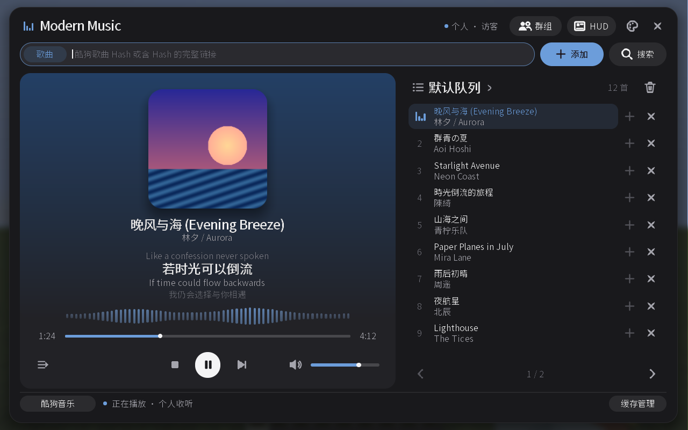

# Modern Music

[简体中文](README.md) | English

Listen to NetEase Cloud Music, QQ Music, Kugou Music, and local audio in Minecraft, with support for individual playback and synchronized listening with other players.

- Search for songs, import playlists, and manage multiple playback queues.
- Play, pause, skip tracks, seek, adjust the volume, and switch repeat modes.
- View album art, lyrics, and an in-game HUD, with ten visual themes to choose from.
- Create listening groups or listen together with your FTB Teams teammates.
- Browse and play local MP3 and WAV files. Drag and drop files to copy them into your local audio library; administrators can also drag and drop files to upload them to the server for use in individual or group queues.

## Installation

Place `modernmusic.jar` in the `mods` folder of your Minecraft game directory. After joining a world, press **Ctrl+M** to open the player. No additional music API service is required.

Individual playback only requires the mod on the client. Synchronized multiplayer listening and shared accounts require compatible versions of the mod on both the server and participating players' clients. Listening with an FTB team also requires FTB Teams and its dependencies. Song availability depends on the music platform and your account's access permissions.

## Documentation

The following guides are currently available in Chinese:

[User Guide](docs/USER-GUIDE.md) · [QQ Music](docs/QQ-MUSIC.md) · [Kugou Music](docs/KUGOU-MUSIC.md) · [Server Shared Accounts](docs/SERVER-SHARED-ACCOUNT.md) · [Visual Themes](docs/THEMES.md)

This project is licensed under the [MIT License](LICENSE). Copyright (c) 2026 Aquariverr. See [Third-Party Notices](THIRD_PARTY_NOTICES.md) for information about third-party components.
