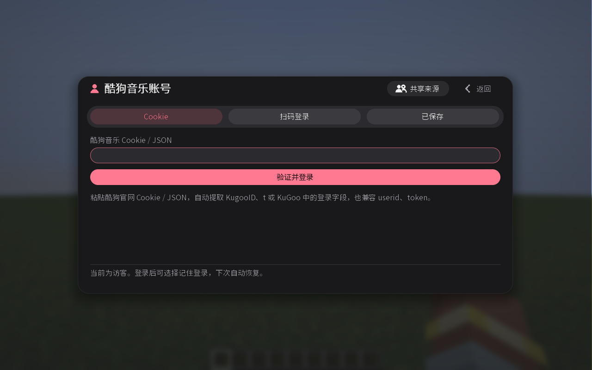

# 酷狗音乐

在播放器左下角切换到 **酷狗音乐**。通用操作见 [使用指南](USER-GUIDE.md)。

## 歌曲与歌单

- 歌曲支持 32 位 Hash（歌曲标识）、带 `hash` 的完整链接，以及官网 `/song/#编码`、`/mixsong/编码.html` 链接。
- 歌单支持数字 ID、`collection_…` ID，以及完整的数字 ID 歌单链接。
- 跳转短链接和 `gcid_…` 歌单链接暂不支持，可改用歌单 ID。

## 登录

使用酷狗音乐 App 扫码并确认，或从酷狗官网登录后导出 Cookie / JSON，粘贴登录。

Cookie 需包含 `userid` 与 `token`。官网导出的 `KugooID`、`t` 和复合 `KuGoo` 字段也能识别，设备和会话字段会自动提取，无需手工转换。

## 限制

仅播放平台授权的完整 MP3，试听片段和无权限歌曲不可播放。服务器共享酷狗账号通过管理员的 Cookie 入口绑定，见 [服务器共享账号](SERVER-SHARED-ACCOUNT.md)。
