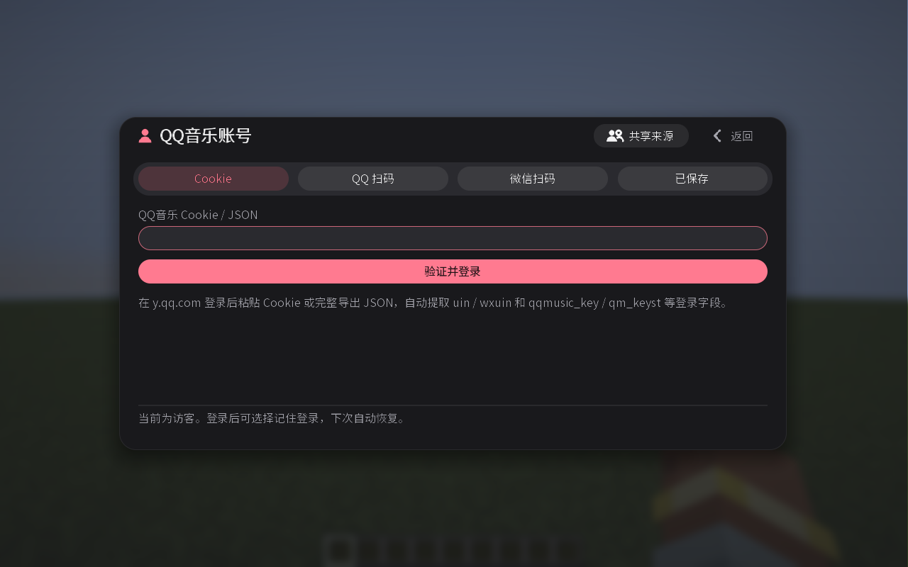

# QQ 音乐

在播放器左下角切换到 **QQ 音乐**。通用操作见 [使用指南](USER-GUIDE.md)。

## 歌曲与歌单

- 歌曲支持数字 ID、14 位 MID，以及 `y.qq.com`、`i.y.qq.com` 的完整歌曲链接。
- 支持带 `#webchat_redirect` 的微信分享链接，以及含 `mid` 的播放器链接。
- 歌单支持数字 ID 或完整歌单链接。
- 分享文本中只能包含一个链接；跳转短链接暂不支持。

## 登录

「QQ 扫码」使用手机 QQ，「微信扫码」使用微信，扫码后确认授权 QQ 音乐。也可从 QQ 音乐官网登录后导出 Cookie 或 JSON，粘贴登录。

Cookie 需包含账号 ID（`uin`、`qqmusic_uin` 或 `wxuin`）和登录密钥（`qqmusic_key` 或 `qm_keyst`）。直接粘贴完整导出即可，无需手工提取。

## 限制

歌曲能否完整播放取决于 QQ 音乐的账号授权。服务器共享 QQ 账号通过管理员的 Cookie 入口绑定，见 [服务器共享账号](SERVER-SHARED-ACCOUNT.md)。
