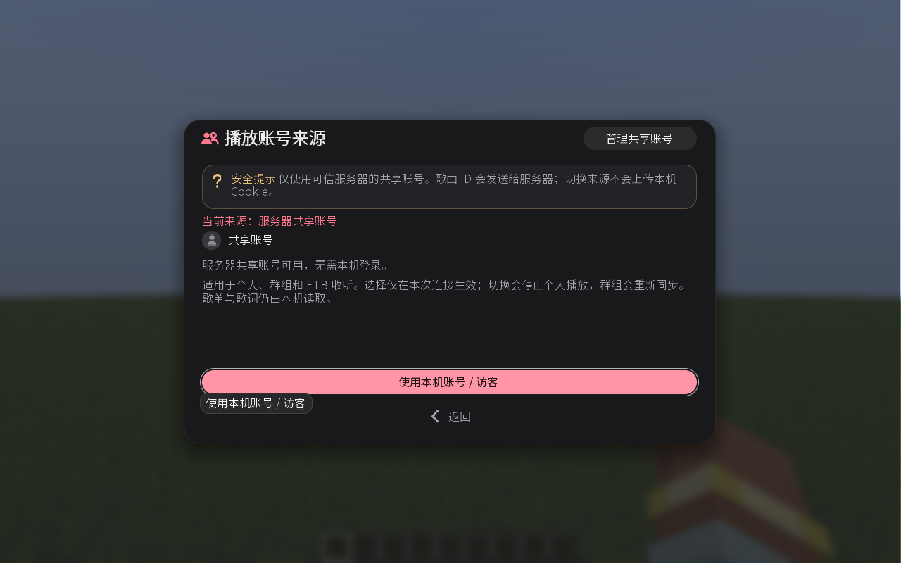

# 服务器共享账号

服务器可分别绑定网易云、QQ 音乐和酷狗的专用账号，供获准玩家播放。需要服务器与客户端安装兼容版本。

## 管理员绑定

单人世界所有者或权限等级 4 的管理员可操作：

1. 在播放器左下角选择音乐平台。
2. 打开 **账号图标 → 共享来源 → 管理共享账号**。
3. 选择 **Cookie 绑定**，粘贴专用账号的 Cookie 或浏览器 JSON 导出并提交。网易云也支持扫码绑定；如提示安全验证，按界面指引完成。
4. 确认已开启共享，选择「所有玩家」或「仅管理员」。后者允许权限等级 2 及以上的玩家播放。

绑定后自动保存；服务器启动时验证并恢复。新配置默认开启共享，已有配置保留原设置。同一时间只能由一位管理员编辑。

使用专用账号和加密连接。未加密连接可能泄露 Cookie 或扫码数据，服务器管理者也可能访问保存的凭据。

## 玩家使用

打开 **账号图标 → 共享来源 → 使用服务器共享账号**。三个平台分别选择，适用于个人、群组和 FTB 队伍收听。勾选下方的 **保持共享账号登录** 后，下次进入同一服务器时，会在该平台共享账号可用后自动使用。设置按服务器和平台分别保存，重启游戏后仍有效；未勾选时，退出服务器后恢复本机来源。取消勾选不影响本次收听，手动切回本机来源后，本次连接不会自动切回共享账号。

共享账号只显示通用名称和默认头像。切换来源后，个人收听需重新点播放，群组会重新同步；成员权限不变。搜索、歌单和歌词仍使用本机账号权限。

## 维护与保存

- **关闭共享**：停止共享播放，保留账号。
- **退出并移除账号**：确认后删除保存的登录，更换账号前先执行此操作。
- **保存登录状态 / 恢复已保存的登录**：自动保存或恢复失败时手动重试。

配置保存在 `config/modernmusic-common.toml`，每个平台使用独立设置和账号目录：

| 平台 | 配置组 | 私密目录 |
| --- | --- | --- |
| 网易云音乐 | `sharedAccount` | `modernmusic-private/server/` |
| QQ 音乐 | `qqSharedAccount` | `modernmusic-private/server/qq/` |
| 酷狗音乐 | `kugouSharedAccount` | `modernmusic-private/server/kugou/` |

`enabled` 控制共享开关，`operatorsOnly` 控制是否仅管理员可用。Windows 登录记录由系统用户加密，不能直接迁移给其他系统用户；其他系统使用私密文件权限保存。不要公开私密目录。

## 播放限制

Cookie 不发送给听众，玩家直接从音乐平台下载音频。共享关闭、账号过期或权限被撤销时停止播放。不同地区或网络出口可能导致资源不可用；共享账号不能绕过会员、付费、地区或下架限制。
