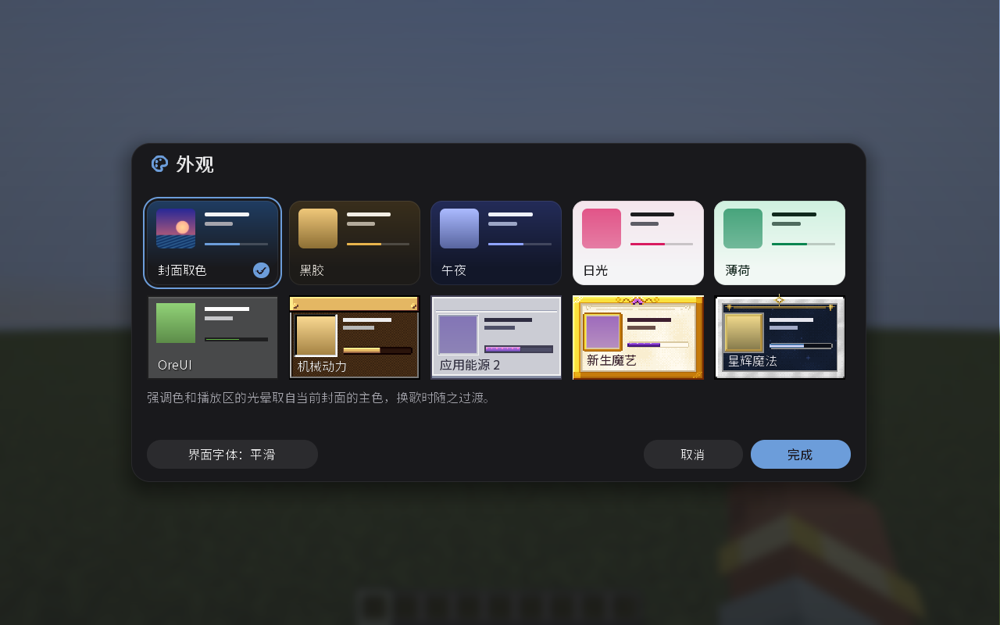
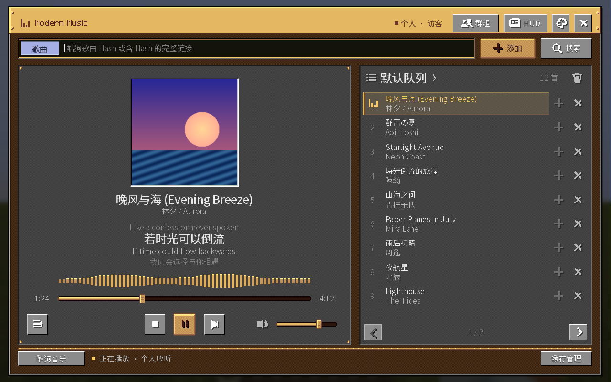
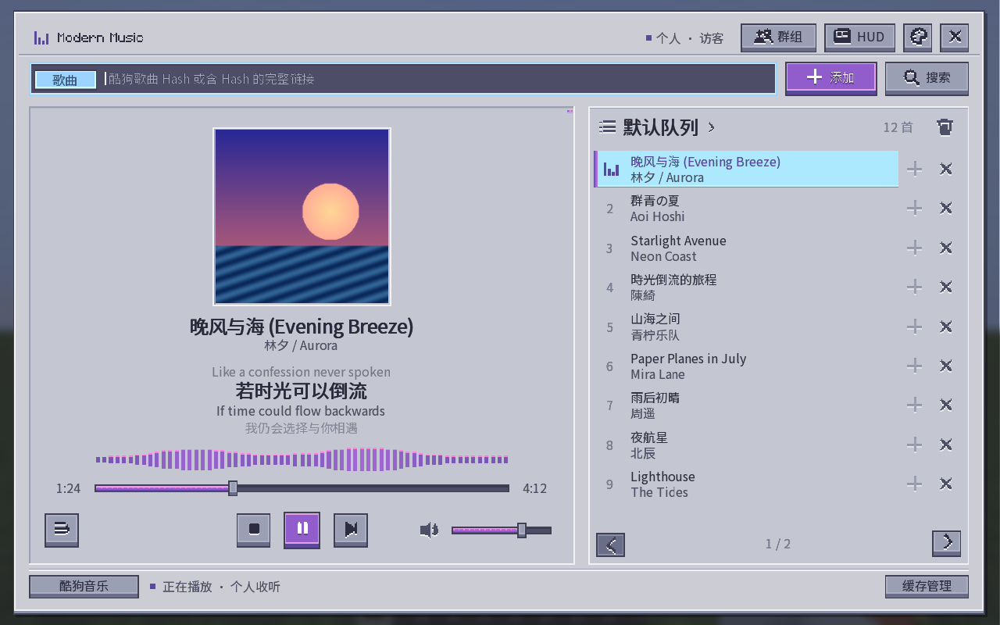
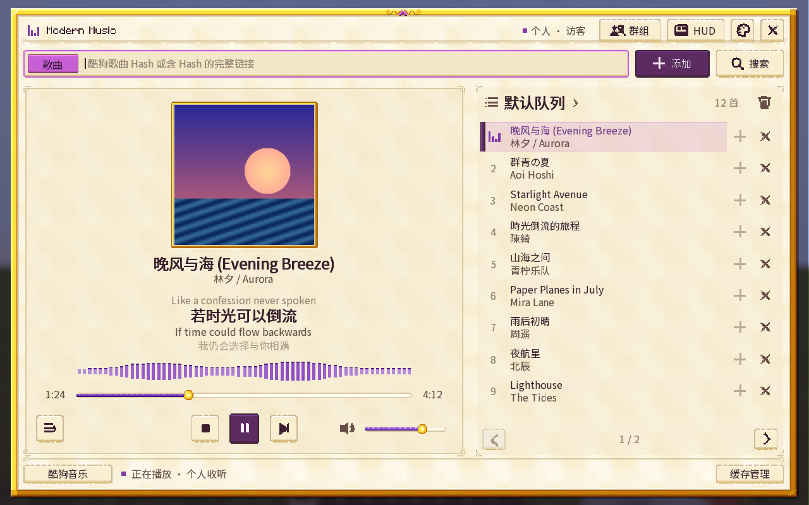
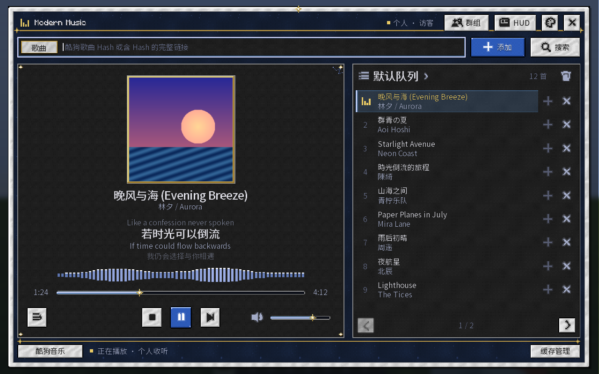

# 外观主题

点击播放器右上角的调色板图标选择主题，所有音乐界面和 HUD 会同步更新。完成或 Esc 保存，取消恢复原设置。

| 主题 | 外观 |
| --- | --- |
| 封面取色（默认） | 深色背景，强调色随封面变化 |
| 黑胶 | 固定配色的深色界面 |
| 午夜 | 深蓝色界面 |
| 日光 | 浅色背景，红色强调色 |
| 薄荷 | 浅色背景，绿色强调色 |
| OreUI | 基岩版风格的像素界面 |
| 机械动力 | 黄铜边框、木质面板 |
| 应用能源 2 | 浅灰面板、紫色控件 |
| 新生魔艺 | 羊皮纸背景、金色边框 |
| 星辉魔法 | 星空背景、大理石边框 |

后四种主题无需安装对应模组。贴图由本项目绘制，来源说明见 [第三方声明](../THIRD_PARTY_NOTICES.md)。

## 机械动力

## 应用能源 2

## 新生魔艺

## 星辉魔法

