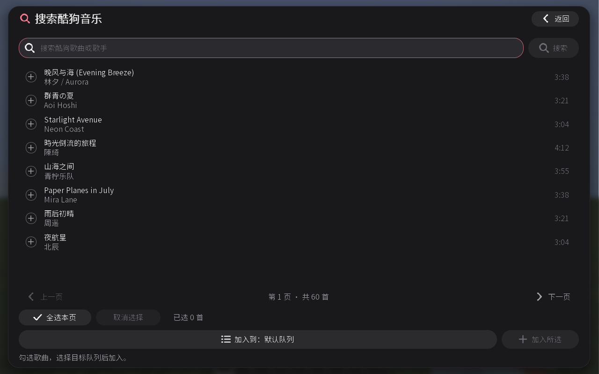
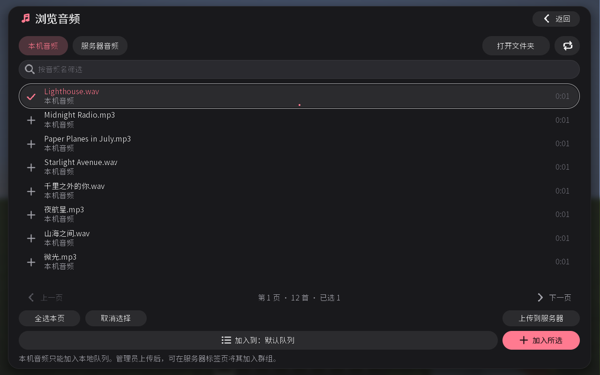
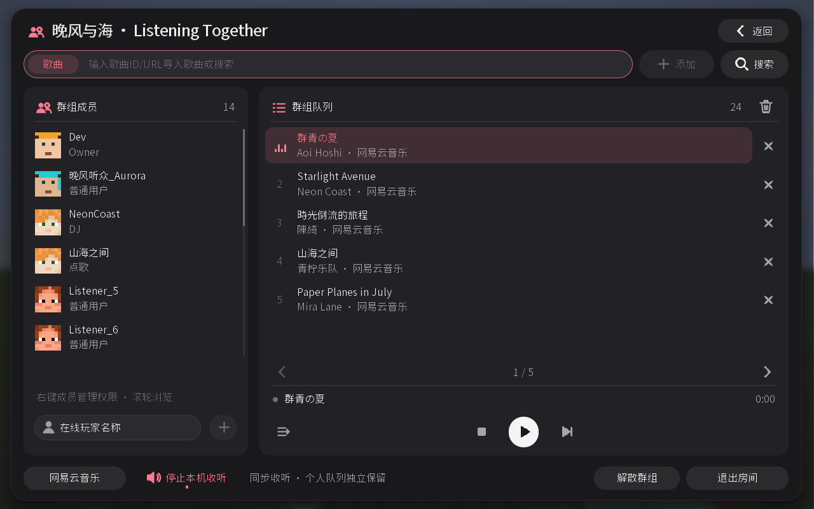

# 使用指南

安装要求见 [项目首页](../README.md)。升级时先退出游戏和服务器，移除旧版 Mod JAR，再放入新版；保留原有配置。不要将源码 JAR 或发布 ZIP 放入 `mods`。

## 播放与队列

进入世界后按 **Ctrl+M** 打开播放器。左下角切换音乐平台，右下角打开缓存管理；搜索、添加和账号入口随平台切换。个人队列可混合在线平台歌曲、本机音频与服务器音频，切换平台不打断播放。

在输入框中输入歌名、歌手、歌曲链接或含单个链接的分享文本，按 **Enter** 搜索或添加。导入 ID 时先选择「歌曲」或「歌单」。QQ 和酷狗的支持格式分别见 [QQ 音乐](QQ-MUSIC.md)、[酷狗音乐](KUGOU-MUSIC.md)。

第一首添加的歌曲自动播放，后续歌曲进入队列。使用播放按钮、进度条和音量条控制播放；循环模式包括顺序、单曲循环、列表循环和随机。关闭界面后继续收听，退出世界后停止。

点击队列名称可新建、重命名或切换队列。最多保存 64 个本地队列，每个最多 400 首；同一队列自动跳过重复歌曲。队列重启后保留，但不自动播放。

搜索结果可跨页勾选，在「加入到」中选择目标队列，再点击「加入所选」。加入本地队列不打断当前播放；队列满时，未加入的歌曲保持选中。

## 本机与服务器音频（1.0.0）

点击左下角平台按钮切换到「本地音频」，输入框改为音频名，右侧「搜索」改为「浏览」。文件不需要登录音乐平台，也不支持导入在线歌单。

1. 将 MP3 或 WAV 文件拖入「本机音频」浏览页即可导入，也可以放入游戏目录的 `modernmusic/audio/` 后刷新列表。浏览页提供打开文件夹按钮。
2. 在「本机音频」列表刷新并勾选音频，选择个人队列后加入；也可在主界面输入完整文件名或不含扩展名的音频名添加。存在同名文件时，请从浏览列表选择。
3. 本机文件只能进入个人队列，不能进入群组或 FTB 队伍队列。
4. 服务器安装 1.0.0 后，OP 等级 2 及以上管理员可在本机列表选择一个文件并上传。上传完成后，在「服务器音频」列表查看。
5. 所有玩家均可将服务器音频加入个人队列；具有群组点歌权限的玩家也可将其加入群组队列。上传权限要求管理员身份，个人队列的使用权限不受影响。

浏览页的当前标签页决定拖放目标：「本机音频」将文件复制到本机音频目录，遇到同名文件自动改名；「服务器音频」由 OP 等级 2 及以上管理员直接上传，不额外复制到本机音频目录。原始文件始终保留。切换到本地平台后，也可拖入主播放器直接导入本机音频，或拖入群组页直接上传到服务器。

每次最多拖入 32 个文件。完成后列表自动刷新并选中新音频，选择队列后点击「加入所选」；导入或上传本身不会自动加入队列。底部显示成功和失败数量，悬停可查看失败文件名与原因；单个文件失败不影响本批其他文件。

单个文件最多 32 MiB，解码后的音频最多 96 MiB；WAV 支持单声道或双声道 PCM / IEEE 浮点格式。本机列表最多扫描 512 个目录条目。服务器最多保存 512 个音频、总计 1 GiB。音频传输使用游戏连接，无需额外 Web 服务。

服务器音频保存在服务器目录的 `modernmusic/audio-server/`，随服务器重启保留；备份时请同时保存这个目录与世界队列文件。客户端播放服务器音频需要连接到保存该文件的服务器。多人功能需要服务器和客户端使用兼容的 1.0.0 版本。

## 账号登录

点击右上角账号图标，选择当前平台支持的登录方式：

| 平台 | 登录方式 |
| --- | --- |
| 网易云音乐 | App 扫码、手机验证码、Cookie |
| QQ 音乐 | QQ 扫码、微信扫码、Cookie |
| 酷狗音乐 | App 扫码、Cookie |

扫码后在手机上确认。Cookie 登录可直接粘贴 `name=value; name=value` 字符串，或浏览器导出的完整 JSON，再点击「验证并登录」。支持 Cookie 数组、`{"cookies":[…]}` 和名称与值组成的对象；只提取当前平台的登录字段。遇到冲突或过期提示时，重新登录官网并导出。

「记住登录」将账号保存在本机。各平台账号相互独立；「退出并删除登录」只删除当前平台的记录。邮箱登录暂不支持。服务器账号的使用方法见 [服务器共享账号](SERVER-SHARED-ACCOUNT.md)。

## 快捷键与外观

在 **选项 → 控制 → 按键绑定 → Modern Music** 中设置快捷键。打开播放器默认为 **Ctrl+M**；播放 / 暂停、下一首、停止和 HUD 显示开关默认未绑定。快捷键仅在世界内且没有打开界面时生效。

右上角 **HUD** 可调整封面、歌曲信息、歌词和进度的显示、位置、大小与透明度，也可切换平滑或像素字体。点击调色板图标选择 [外观主题](THEMES.md)。完成或 Esc 保存，取消恢复修改前的设置。

HUD 编辑器默认选中 **整体调整**，可直接拖动整个 HUD；拖动整体边框右下角、滚轮或缩放滑条可等比例调整所有组件及其间距，方向键微调位置（Shift 加速）。整体缩放的 100% 为选中整体时的大小，到达屏幕边缘或组件大小限制时会统一限制。隐藏组件也会一起调整，显示开关和透明度保持不变。点击封面、歌曲信息、歌词或播放进度的名称，可返回单独调整；点击 **整体调整** 可再次一起调整所有组件。面板挡住 HUD 时按 **H** 收起。

## 群组与 FTB 队伍

按 **Ctrl+M → 群组** 创建群组，输入在线玩家名并点击「＋」邀请。受邀玩家接受后开始收听；大厅可重新加入曾加入的群组。

大厅置顶的「服务器公共群组」向服务器内所有玩家开放，点击即可加入，无需邀请。它不占用建群配额，最多同时容纳 1000 人；普通群组仍为 16 人。达到上限后需等待有人退出再加入；此上限是协议边界，不代表服务器的性能容量。已在其他群组收听时，先退出当前群组再加入。

公共群组内，OP 等级 2 及以上的管理员拥有播放、队列和成员权限管理能力，可右键成员授予 DJ 或点歌权限，也可恢复为普通听众或移出成员。普通玩家初次加入默认只能收听；点歌者可添加歌曲，DJ 还可控制播放和管理队列。管理员身份实时跟随服务器权限，不能通过群组菜单授予或撤销；这些管理权限只适用于公共群组。

公共群组常驻且不能解散，管理员无需一直在线。当群组中没有管理员或 DJ 时，正在收听的普通成员会自动补报当前歌曲尚未知晓的时长，使队列能继续自动播放；此报告仅适用于当前歌曲和本次播放，不能覆盖已知时长，也不会授予暂停、跳转、切歌或改队列权限。队列、DJ 和点歌授权会在离线与重启后保留，所有人离开后停止播放，重新加入后手动播放。被移出的玩家仍可再次直接加入，但原来的授权会被撤销。服务器和参与群组的客户端需同时升级到本次修复版；新增时长报告及消息边界已更新协议版本。

成员列表显示玩家皮肤头像（含帽子层）；皮肤尚未加载、加载失败或玩家信息不可用时显示原版默认头像，加载完成后自动更新。

| 角色 | 权限 |
| --- | --- |
| 普通用户 | 收听 |
| 点歌 | 添加歌曲、搜索加入、导入歌单 |
| DJ | 点歌、控制播放、管理队列 |
| Owner（房主或队长） | DJ 权限，以及管理成员权限 |
| 管理员（仅公共群组） | DJ 权限，以及管理成员权限；身份由 OP 等级 2 及以上决定 |

房主或队长右键点击成员名称设置权限。自建群组还可移出成员；FTB 成员资格由 FTB Teams 管理。

群组页的输入栏用于群组点歌。主界面仍显示个人队列，点击歌曲右侧「＋」可加入群组队列；播放按钮控制当前收听的群组。「停止本机收听」只将自己静音。

自建群组保留成员权限和队列，离线或服务器重启后仍可加入。所有人离开后停止播放，重新加入后手动播放；只有房主能解散群组。每人默认最多创建 2 个，可在 `<世界目录>/serverconfig/modernmusic-server.toml` 的 `rooms.maxOwnedRooms` 中调整为 0–64，0 表示禁止新建。

FTB 队伍收听需安装 FTB Teams 2001.3.1、FTB Library 2001.2.9 和 Architectury 9.2.14 的 Forge 1.20.1 版本。加入队伍后主动选择「加入 FTB 队伍收听」。队列会保存，点歌和 DJ 权限在退出或断线后需重新授予。

## 常见问题

- **没有声音**：检查播放器音量、Minecraft 主音量、唱片机 / 音符盒音量和系统默认输出设备。更换设备后停止再播放。
- **歌曲无法播放**：重新验证账号，检查平台播放权限；搜索结果不保证可以播放。在线平台目前只支持完整 MP3，本机和服务器文件支持 MP3、WAV。
- **封面或歌词未加载**：进入「缓存管理」清理临时缓存后重试。清理会停止本机播放，保留队列、账号和设置。
- **资源重载后停止播放**：F3+T 或重载音频设备会停止播放；个人收听重新点播放，群组收听切换一次静音再恢复。
- **群组或共享入口不可用**：检查服务器是否安装兼容版本。未安装的服务器仍可使用个人播放。
- **反馈问题**：提供版本、系统、操作步骤和脱敏日志，不要发送 Cookie、验证码或私密目录。

## 保存位置

以下路径相对于游戏目录：

| 路径 | 内容 |
| --- | --- |
| `config/modernmusic-queues.json` | 本地队列 |
| `config/modernmusic-hud.json` | HUD、主题和字体设置 |
| `modernmusic-private/` | 记住的账号 |
| `modernmusic/audio/` | 本机音频文件 |
| `modernmusic/audio-server/`（服务器目录） | 上传的服务器音频及索引 |
| `<世界目录>/data/modernmusic-rooms.json` | 自建群组与服务器公共群组的队列、成员授权 |
| `<世界目录>/data/modernmusic-team-queues.json` | FTB 队列 |

音频缓存不写入磁盘。分享整合包或服务器文件时，排除私密目录和个人日志。
